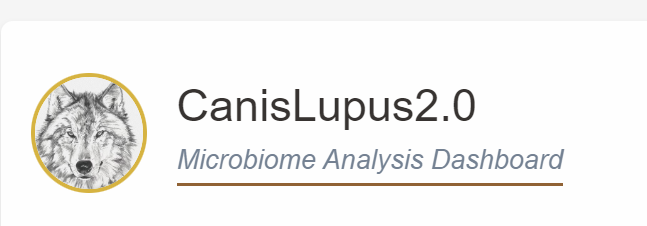
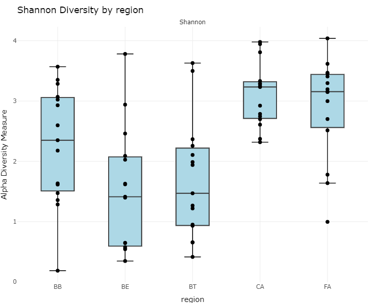

[](https://doi.org/10.5281/zenodo.21287079)
[](https://github.com/barah123/canis_lupus2.0/actions/workflows/r-tests.yml)


---

## Table of Contents (NEEDS TO BE EDITED) 
- [Project Overview](#project-overview)
- [Features](#features)
- [How to Use](#how-to-use)
- [Key Analyses](#key-analyses)
- [Testing](#testing)
- [Recognition](#recognition)
- [How to Cite](#how-to-cite)
- [Contributing](#contributing)
- [License](#license)
- [Contact](#contact)

---
## Introduction (LIZ): 
Bacterial communities inhabiting the skin, gastrointestinal tract, and our surrounding environment play important roles in human health, disease development, and the ecosystem. These microbial communities, collectively referred to as the microbiome, contribute to processes such as nutrient metabolism, immune system regulation, pathogen resistance, and maintenance of physiological homeostasis. Studying these communities allows researchers to characterize microbial diversity, investigate changes in community composition and understand interactions between microorganisms and their hosts (Gotschlich et al., 2019).

Technological advancements in genomics, and high-throughput sequencing technologies have substantially expanded our ability to characterize microbial communities without requiring the isolation and cultivation of individual microorganisms. In particular, sequencing of the bacterial 16S ribosomal RNA (rRNA) gene has become a widely used approach for profiling bacterial community composition and diversity across different environments and biological samples (Gotschlich et al., 2019).

- Public Health Connection + Health Importance
  
### How is microbiome data analyzed? 
Microbiome analysis involves experimental and computational steps, beginning with sample collection and ending with statistical interpretation of microbial community profiles. The selection of an appropriate sequencing approach depends on the research question, sample type, and level of microbial characterization required (Knight et al., 2018).

**Sample collection and DNA extraction** \
The first step involves collecting biological or environmental samples, such as stool, skin swabs, soil, or water. Microbial DNA is subsequently extracted from the samples to obtain genetic material for sequencing. Proper sample collection, storage, and DNA extraction are important because differences in sample handling and microbial cell disruption can introduce technical variation and influence the resulting microbial profiles (Liu et al., 2022).

**Sequencing** \
Several sequencing approaches are used to characterize microbial communities. 16S rRNA gene sequencing is commonly used to profile bacterial and archaeal community composition, while ITS sequencing is used to characterize fungal communities. Shotgun metagenomic sequencing analyzes total microbial DNA to identify microorganisms and assess their functional potential. In contrast, metatranscriptomic sequencing analyzes microbial RNA to investigate gene expression and understand which microbial functions are actively being performed within a community (Knight et al., 2018; Quince et al., 2017)

**Bioinformatics processing and taxonomic classification** \
Following sequencing, the raw reads undergo quality control to remove low-quality sequences and potential contaminants. Sequences are then processed using bioinformatics tools to identify unique microbial sequence variants. These may be represented as amplicon sequence variants (ASVs) or operational taxonomic units (OTUs), depending on the analytical approach. The resulting sequences are compared against reference databases, such as SILVA, to assign taxonomic classifications ranging from phylum to genus and, where resolution permits, species (Callahan et al., 2016; Liu et al., 2022).

**Statistical analysis and interpretation** \
Once microbial sequences have been processed and classified, statistical analyses are performed to characterize microbial communities and investigate differences between sample groups. Researchers commonly examine alpha diversity, which describes microbial diversity within an individual sample, and beta diversity, which measures differences in microbial community composition between samples. Additional analyses may investigate the relative abundance of specific microbial taxa, identify differentially abundant microorganisms, and assess associations between microbial composition and clinical or environmental variables (Knight et al., 2018; Nearing et al., 2022)


- Introduce Canis Lupus
 
--- 
# Canis Lupus Overview 
A Shiny App that runs locally in your device and will analyze and visualize microbiome data. 

---
## Objective 

CanisLupus2.0 is a user-friendly, web-based tool designed for researchers and bioinformaticians to explore, analyze, and visualize microbiome datasets without needed coding experience. Built with R, Shiny, and phyloseq, this app allows users to upload their data and perform comprehensive analyses.

---
## Main Features <a name="features"></a>
Need to rephrase all of this! 
- **Two data types**: Amplicon (ASV/OTU table + taxonomy) or shotgun taxonomic profiles can be uploaded to be analyzed. 
- **Preprocessing & QC**: Singleton removal and minimum-read-depth filtering (automatically skipped for relative-abundance profiles), with a sequencing-depth plot and downloadable dataset summary
- **Visual Exploration**: The tool provides interactive bar plots, pie charts, rarefaction curves, phylogenetic trees, and metacoder heat trees
- **Community Analysis**: Alpha/beta diversity, PERMANOVA, differential abundance, core microbiome, abundance heatmaps, and co-occurrence networks
- **Repeated-measures aware**: Automatically switches to a Friedman test instead of Kruskal-Wallis when a complete blocked/repeated-measures design is detected
- **User-Friendly UI**: Intuitive interface with themed styling
- **Runs Locally**: No server upload required, so unpublished data stays on your machine
- **Tested**: Automated `testthat` suite covering core helpers, run on every push via GitHub Actions
 
 --- 
## Recognition & Adoption (usage) <a name="recognition"></a> 
One sentence giving context? 
Awards: 
- **1st Place, 2025 George Washington University Open Source Software Competition Awards**(link OSPO: https://ospo.gwu.edu/2025-student-open-source-awards-winners-0)
  
Conferences: 
- **Conference presentation** at **ISMB 2026** (Intelligent Systems
for Molecular Biology), Microbiome COSI track, hosted by the International Society for Computational Biology (ISCB) — Washington, .DC. (https://www.iscb.org/ismb2026/scientific-programme/posters)search for the title: B-192: CanisLupus2.0: An Open-Source Interactive Dashboard for Microbiome Data Analysis and Visualization

- **Conference Presentation:Regular at Talk at 2026 George Washington University Open Source Conference**(letter and website for talk: https://ospo.gwu.edu/open-source-conference-2026)
  
- **Poster presentation at George Washington University,Milken school of Public Health Research Day,date and linK here:** Wednesday, April 15, 2026, page 40 (https://emma assets.s3.amazonaws.com/ufigb/95ecdd1aa0d7395d3e0a703b38f061d8/GWSPH_Research_Day_2026_Abstract_Booklet_Updated04102026.pdf)
---
## How to Use <a name="how-to-use"></a>
You can run the app via GitHub Actions ((see [`.github/workflows/r-tests.yml`](.github/workflows/r-tests.yml)): 
```r 
testthat::test_dir("tests/testthat")
```

You can run the app locally through R: 
1. Install R and the required libraries and packages 
Packages Required:
Install Bioconductor packages if not installed:
install.packages("BiocManager")
CRAN packages: 
cran_packages <- c(
  "shiny",
  "microbiome",
  "plotly",
  "DT",
  "vegan",
  "ape",
  "ggplot2",
  "tidyverse",
  "metacoder",
  "networkD3",
  "heatmaply",
  "patchwork",
  "RColorBrewer",
  "viridis",
  "igraph",
  "cowplot",
  "ggdendro",
  "dendextend",
  "reshape2",
  "scales"
)


2. Open and run `app.R` — the Shiny app opens in your browser
    
3. Sample datasets can be downloaded from the Repository (UPLOAD Colorectal cancer DATA) 
   
| Dataset | Folder | Data type | Notes |
|---|---|---|---|
| Human skin microbiome | `skin_data/` | Amplicon (ASV table) | Body-site comparison, used for validation |
| Inflammatory bowel disease (IBD) | `IBD_data/` | Amplicon (ASV table) | Includes a phylogenetic tree |
| Colorectal cancer vs. control / HMP body sites | `sample_data_shotgun/` | Shotgun (MetaPhlAn profiles) |  

4. Upload data on the Data Upload & QC tab:
   - Upload data on its specific format option (ASV table, taxonomy table, metadata table, phylogenetic tree)
     
5. Click **Load & process data** and review the sequencing-depth plot and dataset summary

6. Explore the **Diversity**, **Taxonomy**, **Phylogenetics**, **Networks**, and **Statistics** menus with different taxonomic levels, grouping variables, and statistical parameters
   
These are the plots that will be created:
<div align="center">
  
  
  
  
  
  
  
  
</div>
   
---

## Key Analyses <a name="key-analyses"></a>
- **Taxonomic profiling**: interactive stacked bar plots, pie charts, and metacoder heat trees at user-selected taxonomic levels
- **Alpha diversity**: Observed richness, Chao1, ACE, Shannon, Simpson, InvSimpson, and Fisher indices, with per-sample, by-group, and group-comparison (Kruskal-Wallis or Friedman) views
- **Beta diversity**: PCoA, NMDS, RDA, and CCA ordination over Bray-Curtis, Jaccard, (weighted) UniFrac, or Euclidean distance, with PERMANOVA group testing
- **Phylogenetics**: interactive phylogenetic tree viewer (rectangular, circular, fan, or radial layout)
- **Core microbiome**: detection of taxa consistently present across samples at user-defined abundance and prevalence thresholds
- **Networks & clustering**: CLR-normalised abundance heatmaps, hierarchical clustering/dendrograms, and taxon co-occurrence networks
- **Differential abundance**: Kruskal-Wallis (or Friedman for repeated measures) per taxon with Benjamini-Hochberg correction, shown as volcano plots and results tables
- **Data transformations**: CLR and compositional transformation views (ordination and distribution)

---

## How to Cite <a name="how-to-cite"></a>
If you use CanisLupus2.0 in your work, please cite the software release:

> Appiah, P., Fadaq, A., Banda-Arnold, E., De Torres, C., Perez-Losada, M., Ortega-Santos, C., & Crandall, K. (2026). *CanisLupus 2.0: An Interactive R Shiny Application for Microbiome Data Analysis* (Version v2.0.0) [Computer software]. Zenodo. https://doi.org/10.5281/zenodo.21287079

---

## License <a name="license"></a>

This project is licensed under the terms of the [MIT license](LICENSE).
You are free to use, modify, and distribute this work, subject to the
conditions specified in the LICENSE file.

---

### Contact <a name="Contact"></a>
For questions or collaboration, please contact: [pyappiah561@gmail.com](mailto:pyappiah561@gmail.com)

