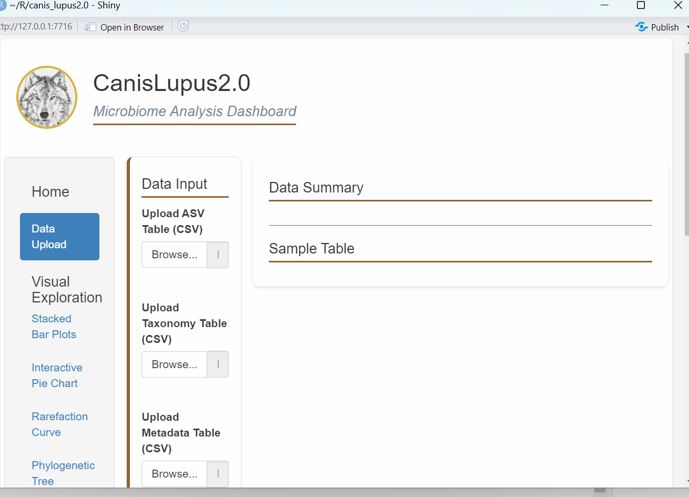
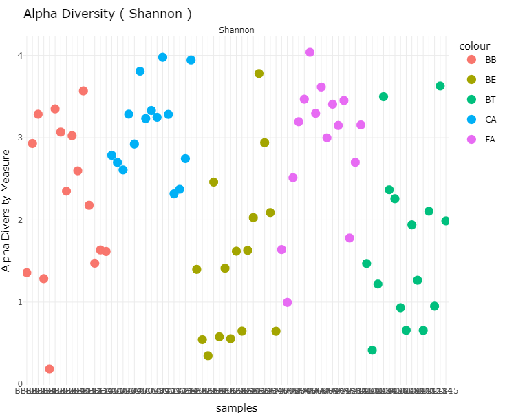
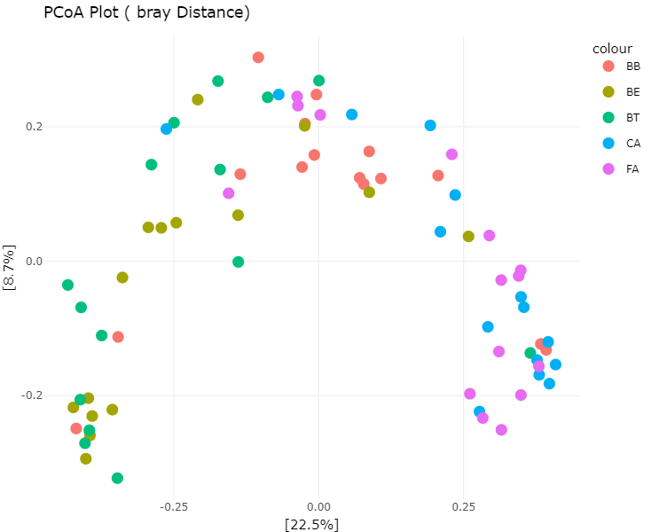

[](https://doi.org/10.5281/zenodo.21287079)
[](https://github.com/barah123/canis_lupus2.0/actions/workflows/r-tests.yml)


---

## Table of Contents (NEEDS TO BE EDITED) 
- [Project Overview](#project-overview)
- [Features](#features)
- [How to Use](#how-to-use)
- [Key Analyses](#key-analyses)
- [Testing](#testing)
- [Recognition](#recognition)
- [How to Cite](#how-to-cite)
- [Contributing](#contributing)
- [License](#license)
- [Contact](#contact)

---
## Introduction (LIZ): 
- Why do we care about microbiome data?
- Public Health Connection + Health Importance
- How is microbiome data analyzed?
- Introduce Canis Lupus

- Bacterial communities of the skin, gut and environment play important roles in to human health, disease, and the environment. In human health, 
- By these commensal microbes, we are able to understand what communities are present, what molecules are produced post interventions and interactions
--- 
# Canis Lupus Overview 
A Shiny App that runs locally in your device and will analyze and visualize microbiome data. 

---
## Objective 

CanisLupus2.0 is a user-friendly, web-based tool designed for researchers and bioinformaticians to explore, analyze, and visualize microbiome datasets without needed coding experience. Built with R, Shiny, and phyloseq, this app allows users to upload their data and perform comprehensive analyses.

---
## Main Features <a name="features"></a>
Need to rephrase all of this! 
- **Two data types**: Amplicon (ASV/OTU table + taxonomy) or shotgun taxonomic profiles can be uploaded to be analyzed. 
- **Preprocessing & QC**: Singleton removal and minimum-read-depth filtering (automatically skipped for relative-abundance profiles), with a sequencing-depth plot and downloadable dataset summary
- **Visual Exploration**: The tool provides interactive bar plots, pie charts, rarefaction curves, phylogenetic trees, and metacoder heat trees
- **Community Analysis**: Alpha/beta diversity, PERMANOVA, differential abundance, core microbiome, abundance heatmaps, and co-occurrence networks
- **Repeated-measures aware**: Automatically switches to a Friedman test instead of Kruskal-Wallis when a complete blocked/repeated-measures design is detected
- **User-Friendly UI**: Intuitive interface with themed styling
- **Runs Locally**: No server upload required, so unpublished data stays on your machine
- **Tested**: Automated `testthat` suite covering core helpers, run on every push via GitHub Actions
 
 --- 
## Recognition & Adoption (usage) <a name="recognition"></a> 
One sentence giving context? 
Awards: 
- **1st Place, 2025 George Washington University Open Source Software Competition Awards**(link OSPO: https://ospo.gwu.edu/2025-student-open-source-awards-winners-0)
  
Conferences: 
- **Coference presentation** at **ISMB 2026** (Intelligent Systems
for Molecular Biology), Microbiome COSI track, hosted by the International Society for Computational Biology (ISCB) — Washington, .DC. (https://www.iscb.org/ismb2026/scientific-programme/posters)search for the title: B-192: CanisLupus2.0: An Open-Source Interactive Dashboard for Microbiome Data Analysis and Visualization

- **Conference Presentation:Regular at Talk at 2026 George Washington University Open Source Conference**(letter and website for talk: https://ospo.gwu.edu/open-source-conference-2026)
  
- **Poster presentation at George Washington University,Milken school of Public Health Research Day,date and linK here:** Wednesday, April 15, 2026, page 40 (https://emma assets.s3.amazonaws.com/ufigb/95ecdd1aa0d7395d3e0a703b38f061d8/GWSPH_Research_Day_2026_Abstract_Booklet_Updated04102026.pdf)
---
## How to Use <a name="how-to-use"></a>
You can run the app via GitHub Actions: 
CanisLupus2.0 has an automated `testthat` suite covering key helpers (e.g., the amplicon/shotgun data coercion, the phylogenetic/UniFrac guard, and the repeated-measures test-selection logic). Run it locally with: ```r testthat::test_dir("tests/testthat")```
Tests run automatically on every push and pull request via GitHub Actions (see [`.github/workflows/r-tests.yml`](.github/workflows/r-tests.yml)).

You can run the app locally through R: 
1. Install R and the required libraries and packages 
Packages Required:
Install Bioconductor packages if not installed:
install.packages("BiocManager")
CRAN packages: 
cran_packages <- c(
  "shiny",
  "microbiome",
  "plotly",
  "DT",
  "vegan",
  "ape",
  "ggplot2",
  "tidyverse",
  "metacoder",
  "networkD3",
  "heatmaply",
  "patchwork",
  "RColorBrewer",
  "viridis",
  "igraph",
  "cowplot",
  "ggdendro",
  "dendextend",
  "reshape2",
  "scales"
)


2. Open and run `app.R` — the Shiny app opens in your browser
    
4. Load Sample data
Three example datasets (available on the Repo for download) to try before uploading your own data:

| Dataset | Folder | Data type | Notes |
|---|---|---|---|
| Human skin microbiome | `skin_data/` | Amplicon (ASV table) | Body-site comparison, used for validation |
| Inflammatory bowel disease (IBD) | `IBD_data/` | Amplicon (ASV table) | Includes a phylogenetic tree |
| Colorectal cancer vs. control / HMP body sites | `sample_data_shotgun/` | Shotgun (MetaPhlAn profiles) | See [`sample_data_shotgun/README.md`](sample_data_shotgun/README.md) for details |

4. For each sample choose its correct data type on the **Data** tab:
   - **Amplicon (ASV/OTU table)** — upload an abundance table and taxonomy table (plus optional metadata and phylogenetic tree)
   - **Shotgun (taxonomic profile)** — upload one merged profile from MetaPhlAn, Kraken2/Bracken, or similar
   - Leave the upload fields empty to explore a bundled example dataset instead
     
5. Click **Load & process data** and review the sequencing-depth plot and dataset summary

<div align="center">
  
  
  
  
  
  
  
  
</div>
   
6. Explore the **Diversity**, **Taxonomy**, **Phylogenetics**, **Networks**, and **Statistics** menus with different taxonomic levels, grouping variables, and statistical parameters


---

## Key Analyses <a name="key-analyses"></a>
- **Taxonomic profiling**: interactive stacked bar plots, pie charts, and metacoder heat trees at user-selected taxonomic levels
- **Alpha diversity**: Observed richness, Chao1, ACE, Shannon, Simpson, InvSimpson, and Fisher indices, with per-sample, by-group, and group-comparison (Kruskal-Wallis or Friedman) views
- **Beta diversity**: PCoA, NMDS, RDA, and CCA ordination over Bray-Curtis, Jaccard, (weighted) UniFrac, or Euclidean distance, with PERMANOVA group testing
- **Phylogenetics**: interactive phylogenetic tree viewer (rectangular, circular, fan, or radial layout)
- **Core microbiome**: detection of taxa consistently present across samples at user-defined abundance and prevalence thresholds
- **Networks & clustering**: CLR-normalised abundance heatmaps, hierarchical clustering/dendrograms, and taxon co-occurrence networks
- **Differential abundance**: Kruskal-Wallis (or Friedman for repeated measures) per taxon with Benjamini-Hochberg correction, shown as volcano plots and results tables
- **Data transformations**: CLR and compositional transformation views (ordination and distribution)

---

## How to Cite <a name="how-to-cite"></a>
If you use CanisLupus2.0 in your work, please cite the software release:

> Appiah, P., Fadaq, A., Banda-Arnold, E., Perez-Losada, M., Ortega-Santos, C., & Crandall, K. (2026). *CanisLupus 2.0: An Interactive R Shiny Application for Microbiome Data Analysis* (Version v2.0.0) [Computer software]. Zenodo. https://doi.org/10.5281/zenodo.21287079

Machine-readable citation metadata is also available in [`CITATION.cff`](CITATION.cff).

---

## License <a name="license"></a>

This project is licensed under the terms of the [MIT license](LICENSE).
You are free to use, modify, and distribute this work, subject to the
conditions specified in the LICENSE file.

---

### ✉️ Contact <a name="Contact"></a>
For questions or collaboration, please contact:
📧 [pyappiah561@gmail.com](mailto:pyappiah561@gmail.com)

